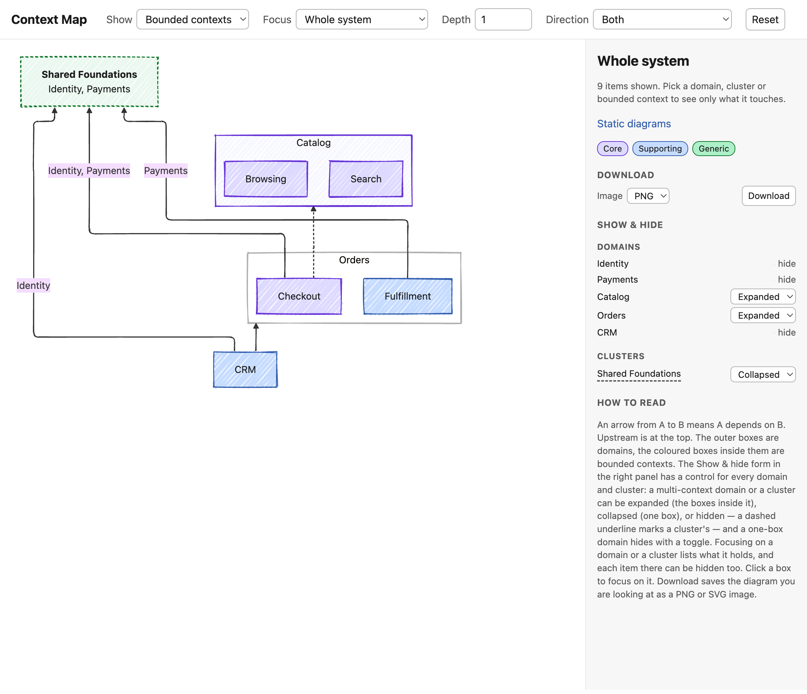

# Context Mapper

Builds a context map: an interactive page plus static Mermaid diagrams of your domains, bounded contexts, and the dependencies between them, from two YAML files. `context-map.yml` says what the map describes; `context-map.style.yml` says how it looks.

[](https://henriquemoody.github.io/context-mapper/)

The interactive page built from the [`example/`](example/) model, published by GitHub Actions — click the picture, or go straight to <https://henriquemoody.github.io/context-mapper/>.

The build fails on unknown ids, duplicates, dependency cycles between bounded contexts, attributes that were never declared or hold the wrong shape, and unknown or invalid `context-map.style.yml` options, so a bad change breaks the build instead of the picture. It warns when two domains depend on each other.

- `src/context_mapper/build.py` validates the model and builds everything.
- `src/context_mapper/graph.py` holds the model logic: levels, lifting context dependencies to domains, and the focus walk.
- `src/context_mapper/mermaid.py` turns views into Mermaid.
- `src/context_mapper/template/` is the interactive page: `index.html`, `style.css`, and its script in three layers — `core/` the pure logic (the model, the graph walk, the URL-hash codec, the Mermaid source generator), `components/` the preact components that render the panel, `dom/` the imperative DOM around them, and `app.js` wiring it all. esbuild bundles `app.js` into `page.js`, and `vendor-entry.js` bundles Mermaid and its ELK loader from npm into `mermaid.js` — both generated, committed, and checked by CI to match their source; the Python build splices the page with the model injected and writes `mermaid.js` next to it.
- `example/` is a small working model you can build right away. It's the cargo shipping system from Eric Evans's *Domain-Driven Design*, as the [DDD Sample](https://github.com/citerus/dddsample-core) app built it.
- `tests/fixtures/` holds the model the tests read. It lives apart, so the example can change without touching the tests.

## A personal project

This is living personal software: I build it for my own needs, and it's purely vibe coded. The focus is meeting my needs, not enabling others. **Anyone is free to use it, copy it, and change it under the ISC license — but I don't intend to maintain it.** The interactive page's script bundles preact and htm (MIT and Apache-2.0). Pin the version you install, because anything here can change without notice.

## Install

Requires Python 3.9+, and the only build dependency is PyYAML — the Mermaid renderer ships as a pinned `mermaid.js` written next to the pages, so nothing is fetched from a CDN.

```sh
pip install context-mapper
```

Pin the version (`context-mapper==<version>`) so a change here cannot break your build unannounced.

Run `context-mapper` in a directory that has a `context-map.yml` and a `context-map.style.yml`. The paths are flags:

```sh
context-mapper --model context-map.yml --diagrams context-map.style.yml --out public
```

While you write the model, `context-mapper serve --watch` serves the site at `http://127.0.0.1:8000/` and rebuilds it whenever you save — the same flags apply.

## The model

```yaml
types:
  core:       { name: Core }                     # the colors live in context-map.style.yml
  supporting: { name: Supporting }
  generic:    { name: Generic }

clusters:                                         # a set of domains or contexts treated together
  foundations: { name: Shared Foundations }

context-map:                                      # every id is a key, exactly once
  payments:                                       # no `domain:` key: a domain
    name: Payments
    type: generic
    cluster: foundations                          # a member of the foundations cluster
    downstreams:                                 # who depends on it, and why
      checkout: Charges the payment method and signals whether it went through.   # a tooltip on the arrow
      fulfillment:                               # a bare key: no comment yet
  catalog:                                       # a dependency can point at a whole domain
    name: Catalog
    type: core
    downstreams:
      checkout:
        comment: Reads prices and availability at checkout time.
        style: dotted                             # or a map, for a styled edge
  checkout:                                      # a `domain:` key makes an entry a bounded context
    name: Checkout
    domain: orders
    description: Takes a cart and turns it into a paid order.   # shows as a tooltip on the box
  fulfillment:
    name: Fulfillment
    domain: orders
    type: supporting                              # a context can override its domain's type
```

Three kinds of thing, in three sections. `types` is the role vocabulary of the model: a domain or bounded context has one. `clusters` names a set of domains or contexts treated together; members join with `cluster:`, and nothing can depend on a cluster. In `context-map`, an entry with a `domain:` key is a bounded context, and any other entry is a domain — one no context points at is a single bounded context. How anything first renders comes from `defaultDisplay` in the style file: a domain or a cluster takes `expanded` (the box and what it holds), `collapsed` (the box alone), `contents` (what it holds, no box), or `hidden` (neither). A bounded context — one box with nothing inside, and a domain no context points at is one too — takes only `expanded` or `hidden`; writing `collapsed` or `contents` for one fails the build, saying why.

Every entry can carry a `description`: the interactive page shows it as a tooltip when you hover over its box, and the item's page shows it under the title.

A domain no context points at is a single bounded context with the same name.

### Violations

`downstreams` says who depends on an entry, and the build fails on a dependency cycle. An existing system doesn't always follow the direction you drew: an upstream calls its own downstream, and writing that as a dependency would make a cycle. Record it as a violation instead, under the one that makes the call, naming what it calls — the same shape as `downstreams`, a key with a comment or a bare key:

```yaml
catalog:
  downstreams:
    checkout: Reads prices and availability at checkout time.   # Checkout → Catalog
  violations:
    checkout: Reads the open carts to warm its cache.           # Catalog → Checkout, in red
```

It draws a red arrow from the entry to each one, with the comment as the tooltip on the interactive page. A violation is a real dependency that is known to be wrong, so it stays out of the dependency graph: it takes no part in cycles, in what a focus or depth reaches, or in a page's "depends on" and "used by" lists, and it is drawn only when both ends are. Between domains it is lifted like a dependency, and it goes when the domains depend that way anyway. A violation never moves anything: Mermaid lays out by the direction of the arrows, so the source draws it the way the dependency runs and the page's script drops the head at the upstream end, leaving the red head where the call goes. Where that script doesn't run — the Markdown files on GitLab — it shows as a red arrow with a head at both ends. The build fails when a violation names an unknown id, the entry itself, or a dependency that is declared already — that one isn't against the direction. Fix the code, then delete the line, and the red arrow goes with it. The arrow's look is `mermaid.edge_styles.violation` in the style file, red by default.

At domain level, context dependencies are lifted to their domains and merged, and dependencies inside a domain disappear.

### Relationship roles

A dependency can say what each side of it is, with the patterns from DDD's context maps. Two optional keys on a `downstreams` entry, next to `comment` and `style`:

```yaml
voyage:
  downstreams:
    booking:
      comment: Books cargo against the published itinerary format.
      upstream: [OpenHostService, PublishedLanguage]   # what voyage is to booking
      downstream: [AnticorruptionLayer]                # what booking is to voyage
```

| Key | Allowed roles | Code |
| --- | --- | --- |
| `upstream` | `OpenHostService` | OHS |
| | `PublishedLanguage` | PL |
| | `Supplier` | S |
| `downstream` | `AnticorruptionLayer` | ACL |
| | `Conformist` | CF |
| | `Customer` | C |

Each key is a list of those names, and the order you write them in doesn't matter. The build fails on a value that isn't a list, an unknown role, a role listed twice, or a role under the wrong key. It fails on combinations that make no sense too:

- `AnticorruptionLayer` and `Conformist` together. A downstream either translates or conforms.
- `Supplier` without `Customer`, or `Customer` without `Supplier`. They come as a pair.
- `Conformist` with `Customer` or `Supplier`. A conformist has no say.

A violation takes a comment and nothing else, so it has no roles. The build says so if you give it a map with `upstream` or `downstream`.

On the interactive page and the static Mermaid pages, the codes are drawn at the ends of the arrow: the upstream's against the upstream's box, the downstream's against the downstream's box, each in a small box beside the line. They are part of the SVG, so a PNG or SVG download keeps them. This needs the page's script: Mermaid's own label sits in the middle of the arrow, and the source only carries a `%% roles:` line that tells the script where to put them. In the Markdown files, where no script runs, the codes go on the middle of the arrow instead: `U: OHS, PL` and `D: ACL` on two lines, leaving out a side with no roles. A collapsed box that names what it holds puts the names first.

Hovering an arrow on the interactive page spells the roles out, in full, above the comment: *Open Host Service, Published Language → Anticorruption Layer*. The panel's "depends on" and "used by" lists show the same text with each name, and so do the lists on every item's page, static and Markdown, after a ` · ` and in muted text: `Billing · Conformist (downstream)`.

When arrows merge, the merged one keeps roles only if every dependency it stands for has the same `upstream` and the same `downstream`. A dependency with no roles is different from one with roles, so one of each drops them. This applies to the domain level, where context dependencies are lifted and merged, and to a collapsed container that folds several arrows into one. A dependency written between two domains keeps its roles, unless context dependencies between them are merged with it. The tooltip and the lists show each dependency's own roles either way.

`mermaid.relationship_labels: false` in the style file stops the drawing: no codes on the diagrams, no `%% roles:` line, no label in the Markdown. The tooltips and the lists keep the roles.

### Partnerships and shared kernels

Some pairs have no direction. Two teams plan and ship together, or two contexts share part of the model itself. Two keys on any entry in `context-map`, a domain or a bounded context, shaped like `violations`, a key with a comment or a bare key:

```yaml
booking:
  partnerships:
    routing: Booking and Routing plan itinerary changes together.
  sharedKernels:
    tracking: Both use the same cargo identity and delivery-spec types.
```

A **partnership** says the two plan and ship together, so neither one is upstream. A **shared kernel** says the two share part of the model: code, types, a schema. Declare a pair once, on either entry.

A partnership is not a violation. A violation is a mistake, measured against a direction you mean to keep: fix the code, delete the line. A partnership says there is no direction between the two, on purpose.

The build fails when:

- the value is not a map, or is empty;
- it names an unknown id, the entry itself, or a cluster, and a cluster can't carry either key;
- the same pair is declared twice, from both ends or under both keys;
- an entry is paired with its own domain, or a domain with one of its contexts;
- the pair has a dependency or a violation between them, in either direction. The partnership or the shared kernel replaces the direction, so keep one of the two.

Neither takes part in cycles. A focus reaches across them in every direction setting, because it is a dependency both ways, so `dir: up` and `dir: down` follow them too. Between domains they are lifted like dependencies: the ones of a kind between the same two domains become one line, with every comment kept for the tooltip, and one inside a domain goes. A pair of domains can end up with a dependency and a partnership both, and both are drawn. They are different facts.

It is drawn as a line with no heads, a thin one for a partnership and a thick one for a shared kernel, with the kind spelled out in the middle: *Partnership*, *Shared Kernel*. That label is part of the Mermaid source, so the Markdown files have it too. A collapsed box that names what it holds puts the names first. `mermaid.relationship_labels: false` takes it off, and then the line is bare. The line's look is `mermaid.edge_styles.partnership` and `mermaid.edge_styles.sharedKernel` in the style file: both default to the look of `solid`, and the shared kernel is a little thicker.

The entry that declares the pair is drawn where an upstream goes: on top with the default direction. Move the line to the other entry and the pair flips. Hovering the line on the interactive page shows the kind and the comments. The panel and every item's page list the item's partners and what it shares a kernel with, each list only when it has someone in it.

## Attributes

An optional `attributes` section declares what extra data the model carries: which service a context is, the aggregates inside it, anything. Nothing is built in — a model declares its own attributes, one type each, and any entry in `context-map` or `clusters` carries its values under `attributes:` too. The build fails on an attribute that was never declared or a value of the wrong shape, so a typo in the data breaks the build instead of hiding. A declared attribute no entry sets is fine, like a type nobody uses.

```yaml
attributes:
  service:    { name: Service, type: text }
  aggregates: { name: Aggregates, type: list }
  metadata:   { type: any }            # the free-form way, for a model that wants one

context-map:
  checkout:
    name: Checkout
    domain: orders
    attributes:
      service: checkout-service
      aggregates: [Order, Cart]
```

| Type | A value |
| --- | --- |
| `text` | A single value. |
| `list` | A list of single values. |
| `map` | A map from label to single value. |
| `any` | Any shape, nesting included. |

The label is the declared `name`, or the attribute id with its first letter uppercased, and the attributes show in the order they were declared. The item's page shows them under the description — the Markdown page too — and so does the interactive page's panel for the focused item, under an Attributes heading: one line per attribute, a map as `label: value` pairs. In the panel a list attribute shows as a list, one item per line; everywhere else — the item's page, the Markdown page, the tooltips — it reads inline, joined with commas. Hovering a box shows them as tooltips too, unless the style file turns that off with `mermaid.attribute_tooltips: false`. `type: any` is the escape hatch: there is no free-form key by default, but a model that wants one declares an attribute named `metadata` and writes whatever it likes there.

## What gets built

| Output | What it is |
| --- | --- |
| `<out>/index.html` | Interactive view. Switch between bounded contexts and domains, click anything to focus on it, hide anything from the side panel, hover a box or an arrow for the details, download the view as a PNG or SVG image. |
| `<out>/mermaid.js` | The Mermaid renderer, vendored and pinned from npm — the one script the pages share. |
| `<out>/mermaid/*.html` | One static Mermaid page per domain, per bounded context, and per named view. Click a box to jump to its page, download the diagram as a PNG or SVG image. |
| `<out>/markdown/*.md` | The same diagrams as Markdown. GitLab renders them natively, and they can go to Confluence. |

## Run locally

```sh
git clone https://github.com/henriquemoody/context-mapper.git
cd context-mapper
pip install .
cd example
context-mapper serve --watch
```

`serve` builds the site and serves it at `http://127.0.0.1:8000/` (`--host` and `--port` to move it, `--out` for the directory). With `--watch`, saving the model or the style file rebuilds the site and the browser reloads the page by itself; a build that fails says why on the terminal and the page keeps showing the last good one, so a broken edit never takes the site down. The reload script is served on the wire only — the files stay exactly what a plain `context-mapper` writes, ready to publish.

The Python tests run with `pytest` from the checkout. The page's script has a JavaScript toolchain of its own — developing it needs Node: `npm ci` to install, `npm test` to run its tests, `npm run build` to rebuild the bundled `page.js`. Using the tool does not need any of that.

## Customize the diagrams

`context-map.style.yml` holds all of it. Its sections mirror the model's — `types`, `clusters`, `context-map` — keyed by the same ids, and take Mermaid's own classDef attributes as keys (`fill`, `stroke`, `stroke-width`, ...), so what you write is what Mermaid draws: a domain's entry styles the box around its bounded contexts, a bounded context's entry styles its own box. Any entry also takes `defaultDisplay`, saying how it first renders — a bounded context hidden that way is hidden like `hide` hides it, everywhere except its own page. The build fails if one points at an id that doesn't exist, on an attribute Mermaid doesn't know, or on a type without `fill` and `stroke`.

```yaml
types:
  core: { fill: "#dedaff", stroke: "#6631d7" }                       # types need fill and stroke

clusters:
  foundations: { fill: "#eaf9ef", stroke: "#067429", stroke-dasharray: "4 3", defaultDisplay: collapsed }

context-map:
  orders: { fill: "#eef4ff", stroke: "#305bab" }                    # overrides mermaid.domain_style
  checkout: { fill: "#fff4f4", defaultDisplay: hidden }             # a bounded context styles its own box, and can start hidden
```

A style also fills in a readable text `color` when you don't set one.

Links sit in a `links` section of their own: a map from the link's text to where it goes, shown in the header of the interactive page in the order written. A repository — on GitHub, GitLab or anywhere else — an issue tracker, a document, anything. Without the section, the header shows none.

```yaml
links:
  Repository: https://github.com/henriquemoody/context-mapper
  Issues: https://github.com/henriquemoody/context-mapper/issues
```

The rest lives in the `mermaid` section. Every style in it is a map of the same Mermaid attributes as above, so `focus_style`, `domain_style` and `edge_styles` read like `types`, `clusters` and `context-map`. It styles the interactive page (`index.html`) and the static pages alike, since both are drawn with Mermaid. The interactive page uses the view `defaults` (such as `display` and `hide`) as its starting state. Unknown keys fail the build, so a typo tells you instead of doing nothing.

| Option | Values | What it does |
| --- | --- | --- |
| `direction` | `BT`, `TB`, `LR`, `RL` | Flow direction. `BT` puts upstream on top. |
| `theme` | `base`, `default`, `neutral`, `dark`, `forest` | Mermaid theme. |
| `layout` | `dagre`, `elk` | Layout engine. The HTML pages load ELK when you pick it. |
| `look` | `classic`, `handDrawn` | Mermaid look. |
| `curve` | `basis`, `linear`, `step`, `stepBefore`, ... | Line shape. Set on every edge with `linkStyle ... interpolate`, so it works with any layout. |
| `theme_variables` | map | Passed to Mermaid as-is (fonts, colors). |
| `config` | map | Any other [Mermaid config](https://mermaid.js.org/config/schema-docs/config.html), merged over the above. For example `elk.nodePlacementStrategy`. |
| `markdown_config` | map | Merged over everything for `<out>/markdown/*.md` only. GitLab's built-in Mermaid has no ELK, so the example sets `layout: dagre` here. |
| `attribute_tooltips` | `true`, `false` | Whether hovering a box shows its attributes too. The interactive page only; `true` by default. |
| `relationship_labels` | `true`, `false` | Whether the roles of a dependency are drawn on the diagrams, as codes at the ends of the arrow or, in the Markdown, on its middle, and whether a partnership or a shared kernel is named on its line. Tooltips and lists show them either way; `true` by default. |
| `focus_style` | map of Mermaid attributes | How the focused item is highlighted. |
| `domain_style` | map of Mermaid attributes | Style of the box around a domain's bounded contexts. A domain with its own style under `context-map` overrides it — and its type colors, when drawn as one box. |
| `edge_styles.solid`, `edge_styles.dotted`, `edge_styles.violation`, `edge_styles.partnership`, `edge_styles.sharedKernel` | map of Mermaid attributes | Line styles. Dotted comes from `style: dotted` on a downstream; violation is the arrow of a `violations` entry, red by default; partnership and sharedKernel are the lines of a `partnerships` and a `sharedKernels` entry, like solid by default, the shared kernel thicker. |
| `pages` | `all`, `domains`, `contexts`, or a list of ids | Which items get their own page. |

These can be set under `defaults` and overridden per view:

| Option | Values | What it does |
| --- | --- | --- |
| `level` | `context`, `domain` | Bounded contexts inside domain boxes, or one box per domain. |
| `depth` | whole number, `99` for all | Hops out from the focus. |
| `dir` | `both`, `up`, `down` | Depends on, used by, or both. |
| `display` | `expanded`, `collapsed`, `contents`, `hidden`, or a map from container id to one of those | How containers first render. A single value applies to every container; a map leaves the rest to their own `defaultDisplay` in the style file. |
| `hide` | a list of ids | What the view never draws, no matter what: hiding a domain or a cluster takes everything inside it, hiding a bounded context only its own box and arrows. In the whole system that trims domains and clusters; in a domain's view it leaves out bounded contexts; in a cluster's view, members. The focus itself is never hidden. |
| `child_labels` | `true`, `false` | A collapsed container names what it holds, in the box and on each arrow that reaches it. |
| `group_by_type` | `true`, `false` | Wrap Core, Supporting and Generic in their own boxes. |

A view can also set `id`, `title`, `focus` (a domain, context or cluster id), `description` and `direction`:

```yaml
    - id: catalog-detail
      title: Catalog in detail
      focus: catalog
      display: contents                # or { foundations: contents }
      hide: [search]                   # never draw the Search context here
      direction: LR
```

## Use it in another repository

Keep only the model in your repository and let CI install this tool. Pin the version so the build is reproducible; when you want a newer one, bump it. This GitLab Pages job is all it takes:

```yaml
pages:
  image: python:3.12-slim
  script:
    - pip install --quiet context-mapper==<version>
    - context-mapper
  artifacts:
    paths:
      - public
  rules:
    - if: $CI_COMMIT_BRANCH == $CI_DEFAULT_BRANCH
```

## Links

- `index.html#focus=checkout`: interactive, Checkout and its direct neighbors
- `index.html#focus=foundations`: interactive, the foundations cluster, opened, and what its members touch
- `index.html#level=domain&focus=orders`: interactive, the Orders domain and its neighbors
- `index.html#focus=orders&hide.fulfillment=1`: interactive, the Orders domain without the Fulfillment context
- Other hash options: `depth=<n>`, `dir=both|up|down`, `display.<domain id>=expanded|collapsed|contents|hidden`, `hide.<id>=1|0`
- `mermaid/checkout.html`: static diagram for Checkout
- `mermaid/index.html`: all static diagrams
